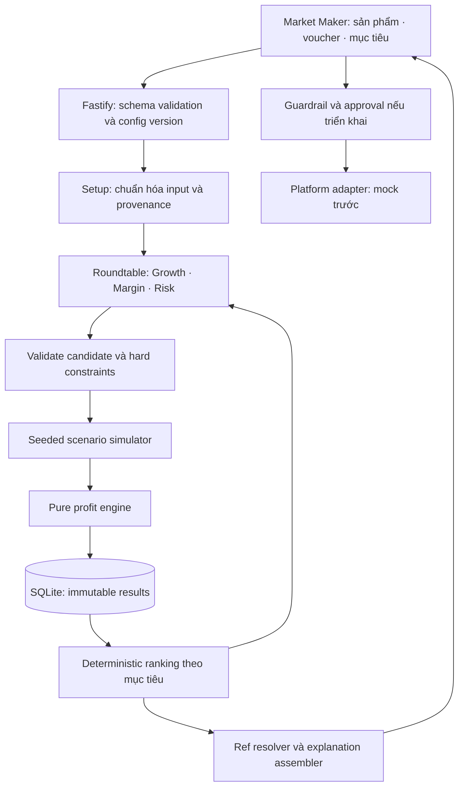

# Market Maker — thiết kế recommendation

Trạng thái: **đề xuất kiến trúc đích**, không phải tuyên bố mọi thành phần đã chạy trong prototype. Đọc cùng [research.md](research.md). Nguồn nội bộ đã đối chiếu: repo `../margin-guard`, `docs/06-architecture.md`, `08-agent-design.md`, `07-data-schemas.md`, `21-simulator.md`, package manifests và `Downloads/margin-guard-field-guide.html`. Không sao chép toàn bộ Margin Guard: Market Maker đặt việc chọn chiến lược trước sự kiện ở trung tâm, thay vì dashboard kiểm toán lỗ.

## Quyết định chính

Giữ Next.js/React → Fastify Node.js → SQLite của app hiện có. Mở rộng orchestrator và simulator, không tách microservice chỉ để chạy nhiều vai trò LLM. LLM tạo phương án, phản biện và giải thích; engine thuần quyết định tất cả kết quả số. Backend chọn phương án hợp lệ theo khẩu vị người bán. Sự đồng thuận của các agent không phải xác suất đúng.

## Input và quyền tùy chỉnh

- Sản phẩm: SKU, category, giá bán/flash/reference, COGS, đóng gói, cân nặng, tồn kho, expected units và return rate. Tiền nguyên đồng, tỷ lệ basis points. Category quyết định fee schedule đã version hóa.
- Voucher: ID, shop/platform/coin, fixed/percent, mức giảm, cap, min spend, quota, per-buyer limit, eligibility SKU, thời gian hiệu lực, co-funding và stacking. Các field trong PDF được đối chiếu tại research; những field bổ sung cho mô phỏng phải gắn nhãn giả định, không nhận là tính năng Seller Centre đã xác nhận.
- Shop voucher là biến người bán có thể đề xuất sửa. Voucher sàn/coin chỉ là điều kiện kịch bản nếu người bán không kiểm soát; không cho optimizer tùy ý sửa chúng. Thời gian dùng Asia/Ho_Chi_Minh, lưu timestamp có offset.
- Khẩu vị: ưu tiên lợi nhuận, doanh số hoặc tránh lỗ; trần ngân sách voucher, floor lợi nhuận, giới hạn thay đổi giá, giới hạn mất tiền và capacity xử lý đơn. Hard constraint luôn thắng preference.
- Traffic: baseline theo ngày/giờ và nguồn, historical visits/orders/CVR, paid budget, sale uplift thấp/cơ sở/cao. `source`, `observed_at`, `status`, đơn vị và phạm vi dữ liệu đi kèm từng giả định.

Giữ `SimulationConfig` hiện có; thêm `risk`, `traffic`, `voucher.eligible_sku_ids`, `starts_at`, `ends_at` dưới contract version mới. Không âm thầm bỏ field mà engine chưa hỗ trợ. Trả 422 kèm path/rule cho input không hợp lệ.

## Roundtable có giới hạn

1. Setup tạo draft từ form hoặc lời người bán; thiếu COGS hoặc fees cần thiết thì ghi thiếu, không suy diễn thành dữ kiện.
2. Growth đề xuất min spend/bundle và phân bổ quota; Margin đề xuất cap, loại SKU biên thấp; Risk phản biện stockout, hết ngân sách sớm, stacking và kịch bản traffic thấp. Các vai trò chạy độc lập trên cùng config snapshot để tránh bám theo ý kiến đầu tiên.
3. Backend chuẩn hóa/deduplicate tối đa 5 candidate kể cả baseline. Chỉ dùng action whitelist và khoảng người bán cho phép. Candidate là input assumptions; không phải kết quả tính toán.
4. Simulator chạy tất cả candidate trên cùng seeds và cùng traffic draws để so sánh công bằng. Mỗi đơn gọi `computeOrderProfit`; engine không đọc clock, network hay random. Randomness nằm ở simulator.
5. Agent phản biện kết quả có `result_id`, tối đa 3 vòng như contract hiện tại. Lưu đề xuất bị loại và rule bị vi phạm. Dừng khi không có candidate mới, hết thời gian/token budget hoặc không cải thiện theo score backend.
6. Ranker trả winner, alternatives và miền điều kiện thắng. Nếu không có phương án hợp lệ: trả `no_feasible_strategy`, không ép chọn. Nếu thiếu dữ liệu: trả đề xuất có điều kiện và nhãn mô phỏng.
7. Explainer chỉ xuất text segments không chứa số và refs hợp lệ. Resolver lấy số từ result store; numeric literal hoặc ref giả bị từ chối. Timeout/provider error dùng deterministic fallback, hiển thị provider thật.

Không cần một LLM cho từng khách hàng mô phỏng. Không trình bày trace như chain-of-thought: chỉ hiển thị vai trò, đề xuất, dữ kiện engine, phản biện ngắn và kết luận.

## Estimate và ranking

Phân tách traffic, conversion và basket size: `orders = visits × CVR`, sau đó mô phỏng basket/qty và giới hạn stock/quota/capacity. Nếu chỉ có expected units, dùng mô hình demand của simulator cũ và ghi rõ không có forecast traffic riêng; không nhân uplift vào cả visits và orders lần nữa.

Khởi đầu với lưới scenario thấp/cơ sở/cao. Chỉ gọi P10/P50/P90 khi thật sự lấy quantile từ nhiều stochastic runs; ba điểm đặt tay là ba kịch bản, không phải khoảng tin cậy thống kê. Không có xác suất scenario đáng tin thì không tuyên bố expected value hoặc probability of loss đã được hiệu chuẩn.

Trong bản đích có lịch sử đủ tốt: fit baseline theo weekday/hour/category; giữ lại sự kiện sale gần nhất làm holdout; uncertainty gồm traffic, CVR, elasticity, return rate và redeem rate. Các candidate chia sẻ shocks để đo chênh lệch. Calibration phải ở từng shop/category; số liệu campaign toàn sàn không thể gán làm uplift của từng SKU.

| Preference | Rule chọn sau hard constraints |
|---|---|
| Tránh lỗ | Ưu tiên downside profit cao hơn; khi có phân phối đã hiệu chuẩn, dùng CVaR loss và loss probability |
| Lợi nhuận | Mean profit cao nhất trong giới hạn downside và ngân sách |
| Doanh số | Orders/revenue cao nhất với profit floor và capacity được giữ |

Khi chưa có phân phối hiệu chuẩn, dùng worst-case của tập scenario và gọi đúng tên. Trả Pareto frontier profit/doanh số/risk thay vì khẳng định tồn tại một winner tuyệt đối. Sensitivity grid phải cho biết khi traffic hoặc CVR đổi thì thứ hạng đảo ở đâu.

## API và lưu trữ

Tái sử dụng `/v1/sim/configs`, `/v1/sim/configs/:id/run`, `/v1/sim/runs/:id`, `/v1/sim/compare`, `/v1/sim/agent/setup`. Mở rộng `/v1/sim/agent/strategist` bằng versioned roundtable response. Phần cũ được giữ qua adapter.

Request recommendation: `{config_id, config_version, objective, risk_profile, scenario_set_id, seed}`. Response: `{recommendation_id, provider, status, candidates, winner_id, reason_segments, scenario_comparison, assumptions, rejected_candidates, trace}`; mỗi metric có ref tới result đã lưu. API server tự mint ID và hash, không tin ID do model cung cấp.

Nếu thời gian chạy vượt request budget, POST trả 202 + job ID; GET job trả phase/progress/result. Đây là mở rộng đề xuất, không giả định đã có queue. MVP có thể chạy bounded synchronous; production dùng persistent job state và idempotency key.

Thêm bảng `recommendation_run`, `strategy_candidate`, `roundtable_turn`, `traffic_dataset_version`; result giữ append-only. Ghi config hash, code/model/prompt version, fee version, seed, sources và cost. Không lưu bí mật trong trace. Áp dụng strategy là endpoint riêng, qua guardrail/ActionToken và before-state snapshot; recommendation tự nó không đổi shop.

## Visualization hướng quyết định

Màn hình: Input → bàn chiến lược → kết quả. Primary card ghi winner và điều kiện áp dụng; cạnh đó là matrix strategy × traffic thấp/cơ sở/cao. Dùng profit bars có mốc zero, budget use, stockout/capacity badges và waterfall khi mở chi tiết. Có baseline để thấy incremental profit. Khi có Monte Carlo thật mới thêm histogram/quantile band. Bảng số song hành với chart cho accessibility và export.

## Kiểm chứng và khoảng trống production

Prototype có thể dùng deterministic local scenarios để kiểm tra UX; phải ghi rõ chưa gọi LLM thật/chưa forecast thị trường/chưa kết nối Shopee nếu các adapter đó chưa được triển khai. Field guide của baseline xác nhận sample catalog và buyer behavior là giả định; không dùng demo để chứng minh uplift thực tế.

Các gaps cần xử lý trước live: định danh buyer để enforce per-buyer quota; rule flash-sale eligibility và giá; phân biệt refused delivery/return; cập nhật fee/stacking theo nguồn hiện hành; OAuth/tenant isolation; đồng bộ tồn kho và budget; secret server-side; audit/redaction; server-side apply có approval; calibration bằng dữ liệu shop. Docs kiến trúc cũ nói một process, nhưng field guide/package hiện tại có hai server; theo triển khai Next.js + Fastify thực tế.

CI cần kiểm tra schema và engine invariants, quota/stock cap, fixed/percent vouchers, min spend/eligibility/time, cofund allocation, same-seed reproducibility, candidate constraints, reject invented refs/numbers và fallback/provider labels. Recommendation eval so với baseline no-change, fixed heuristics, single-agent và roundtable trên cùng scenarios: constraint violation rate, incremental profit, downside, regret đối với oracle trong tập candidate, latency/token cost. Dùng out-of-time holdout và randomised experiment trước tuyên bố tăng lợi nhuận do recommendation; backtest đơn thuần không chứng minh nhân quả.
